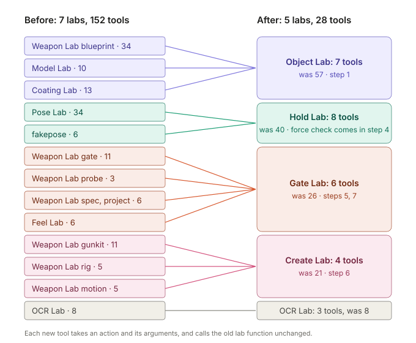
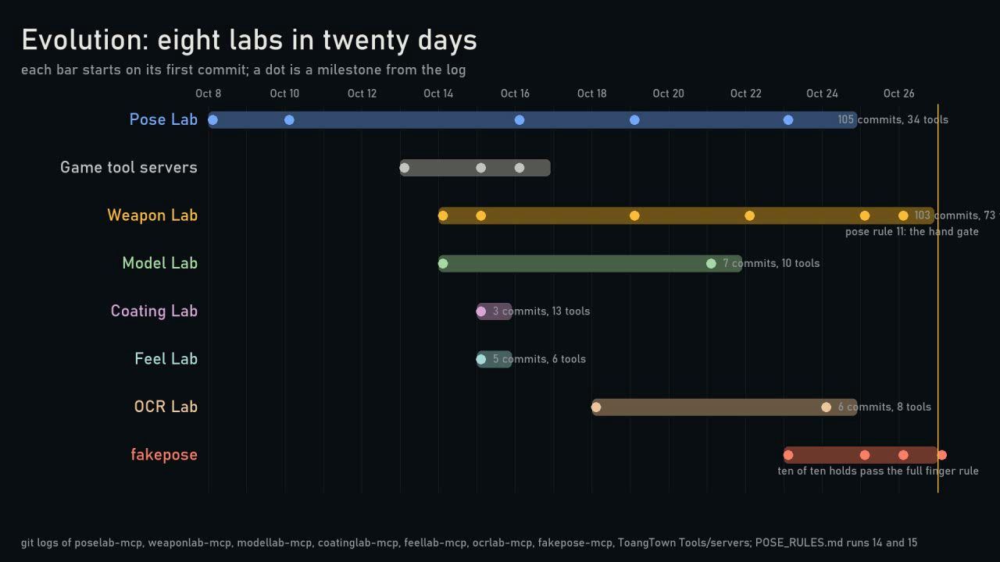
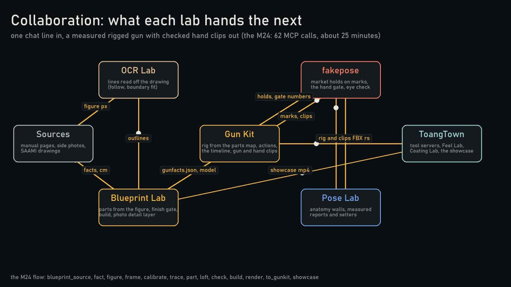
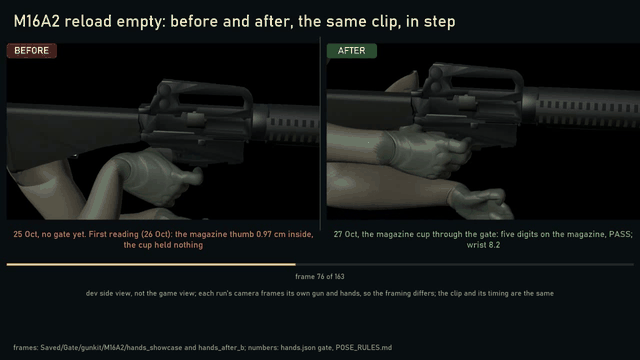
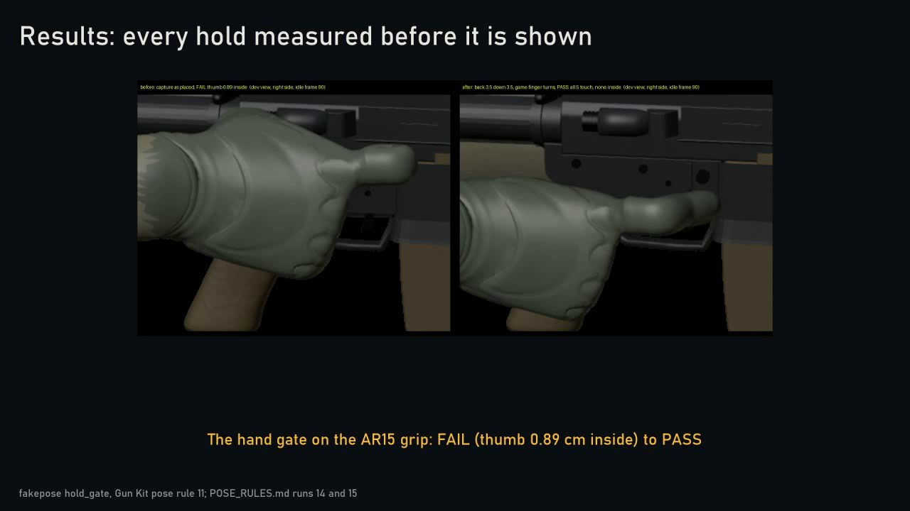
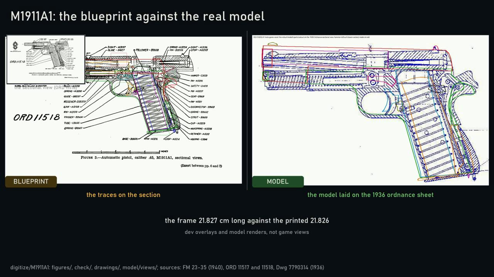
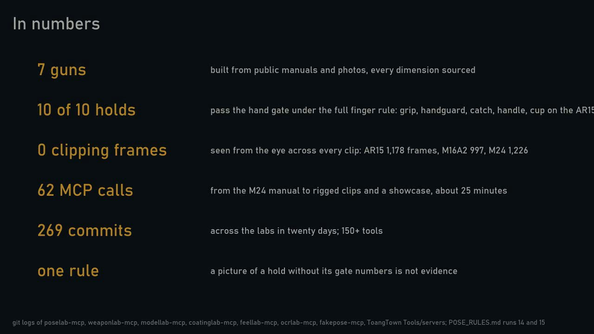

# Labs: a machine that sees physics through numbers

MCP servers that let a model build and judge 3D work by measured numbers: parts, bodies, contacts, forces.
[Tiếng Việt](README.vi.md)

## Goal, in the owner's words

| # | Words |
|---|---|
| G1 | "in real life that will not happen" (no clipping, no twisted finger: hard walls) |
| G2 | "a virtual world like matrix idea where every thing every poly control by numbers, start from the hand and the gun" |
| G3 | "numbers that have meaning to really appreciate physics in digital world so after the physics and object interact is correct I can start the creation automatically" |

## The labs

152 tools in 7 labs became 28 tools in 5 labs on 2026-11-01. Each tool takes an action and its arguments, and calls
the old lab function unchanged. Tests check that each of the 152 old tools is exactly one action.

| Lab | Tools | Was | Does | Plan steps |
|---|---|---|---|---|
| [objectlab-mcp](https://github.com/hpdkhoa/objectlab-mcp) | 7 | 57 | Names every part of an object, measures it from sources, builds it, gives it a finish | 1 |
| [holdlab-mcp](https://github.com/hpdkhoa/holdlab-mcp) | 8 | 40 | Measures the hand and arm, keeps joint limits as walls, places holds by rule | 2, 3, 4 |
| [gatelab-mcp](https://github.com/hpdkhoa/gatelab-mcp) | 6 | 26 | Judges every result against walls and the owner's judgments | 5, 7 |
| [createlab-mcp](https://github.com/hpdkhoa/createlab-mcp) | 4 | 21 | Builds the rig, the holds and the clips for a new object | 6 |
| [ocrlab-mcp](https://github.com/hpdkhoa/ocrlab-mcp) | 3 | 8 | Reads text, lines and outlines from pages and pictures | sources |

The labs underneath stay as packages: poselab-mcp, weaponlab-mcp, modellab-mcp, coatinglab-mcp, feellab-mcp,
fakepose-mcp. The force check (a 29th tool) comes with plan step 4.

## Evidence, from the latest run

From the evolution video of the labs (2026-10-27, 191 s).

| | |
|---|---|
|  |  |
| Eight labs in twenty days, from the git logs | What each lab hands the next |

Before and after on one screen, the same clip in step: the M16A2 reload and the AR-15 chamber check.

| | |
|---|---|
|  |  |
| The hand gate on the AR-15 grip: FAIL (thumb 0.89 cm inside) to PASS | M1911A1: the frame 21.827 cm long against the printed 21.826 |

## Plan steps

| Step | Builds |
|---|---|
| 1 | Meaning on the object: every poly in a named part |
| 2 | Meaning on the body: measured skin, sourced joint limits |
| 3 | Contact rules: which part touches which, its kind and wrap direction |
| 4 | Force check: the hold stays put against weight and recoil |
| 5 | Solve and gate: walls hard, every number reported against its meaning |
| 6 | Automatic creation, after 1 to 5 pass on one approved gun |
| 7 | Owner judgments become checks; false passes go to 0 |

Full plan: [MEANING_PLAN.md](https://github.com/hpdkhoa/poselab-mcp/blob/main/docs/MEANING_PLAN.md).
