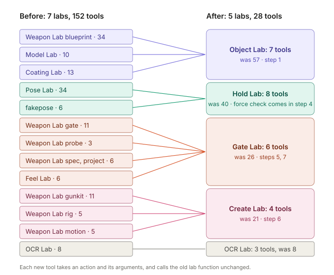
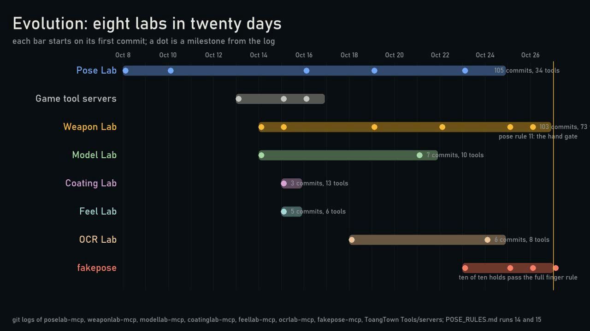
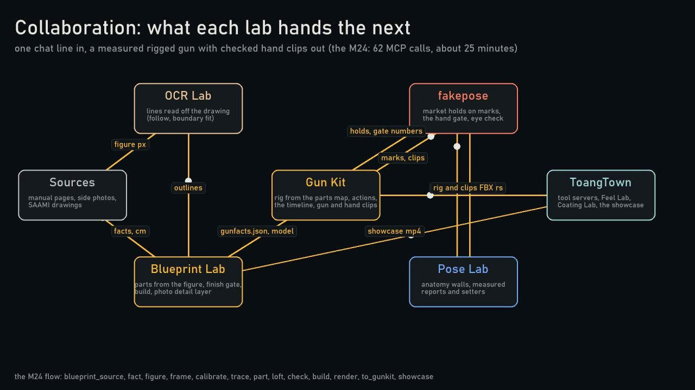
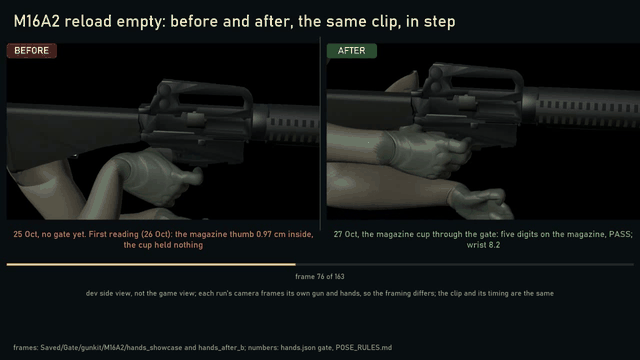
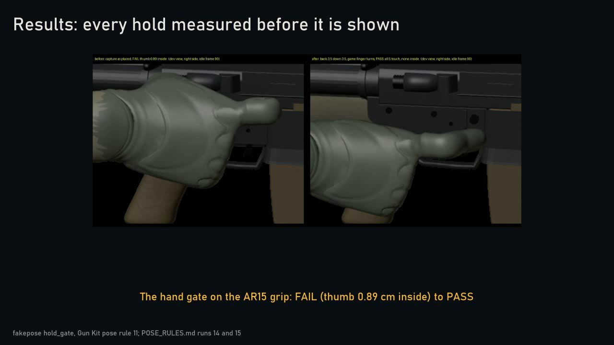
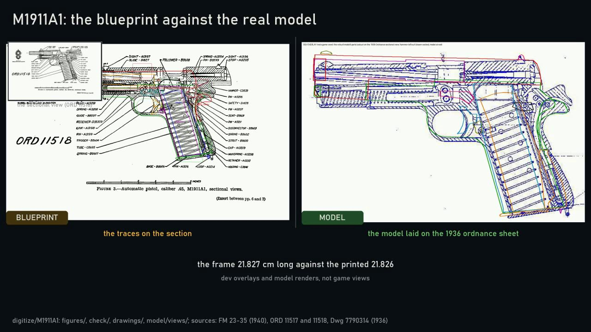
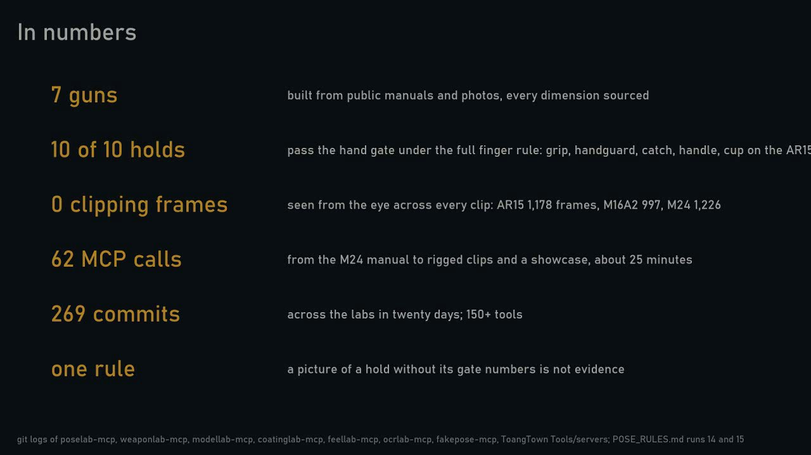

# Labs: máy nhìn vật lý qua con số

Các MCP server giúp model dựng và chấm việc 3D bằng số đo: bộ phận, cơ thể, điểm chạm, lực.
[English](README.md)

## Mục tiêu

| # | Mục tiêu |
|---|---|
| 1 | Không có điều gì đời thật không xảy ra: không xuyên mesh, không ngón tay xoắn. Đó là tường cứng. |
| 2 | Con số điều khiển mọi bộ phận và mọi poly. Tôi bắt đầu từ bàn tay và khẩu súng. |
| 3 | Con số mang nghĩa. Vật lý và điểm chạm đi trước; tạo tự động đi sau. |

## Các lab

Ngày 2026-11-01, 152 công cụ trong 7 lab gộp thành 28 công cụ trong 5 lab. Mỗi công cụ nhận một action và tham số
của nó. Nó gọi đúng hàm cũ của lab, không đổi. Một test kiểm mỗi công cụ cũ là đúng một action.

| Lab | Công cụ | Trước | Làm gì | Bước |
|---|---|---|---|---|
| [objectlab-mcp](https://github.com/hpdkhoa/objectlab-mcp) | 7 | 57 | Đặt tên mọi bộ phận của vật, đo từ nguồn, dựng, phủ bề mặt | 1 |
| [holdlab-mcp](https://github.com/hpdkhoa/holdlab-mcp) | 8 | 40 | Đo tay và cánh tay, giữ giới hạn khớp làm tường, đặt tay cầm theo luật | 2, 3, 4 |
| [gatelab-mcp](https://github.com/hpdkhoa/gatelab-mcp) | 6 | 26 | Chấm mọi kết quả theo tường và theo nhận xét của tôi | 5, 7 |
| [createlab-mcp](https://github.com/hpdkhoa/createlab-mcp) | 4 | 21 | Dựng rig, tư thế cầm và clip cho vật mới | 6 |
| [ocrlab-mcp](https://github.com/hpdkhoa/ocrlab-mcp) | 3 | 8 | Đọc chữ, đường nét và đường viền từ trang và ảnh | nguồn |

Các lab cũ nằm dưới các lab mới, vẫn là package riêng: poselab-mcp, weaponlab-mcp, modellab-mcp, coatinglab-mcp,
feellab-mcp, fakepose-mcp. Kiểm lực, công cụ thứ 29, đến ở bước 4.

## Bằng chứng từ lần chạy mới nhất

Khung hình từ video tiến hóa của các lab (2026-10-27, 191 giây).

| | |
|---|---|
|  |  |
| Tám lab trong hai mươi ngày, theo git log | Lab nào chuyển gì cho lab sau |

Trước và sau trên cùng một màn hình, cùng clip chạy song song: thay đạn M16A2 và kiểm buồng đạn AR-15.

| | |
|---|---|
|  |  |
| Cổng kiểm tay ở báng AR-15: FAIL (ngón cái lún 0,89 cm) thành PASS | M1911A1: khung dài 21,827 cm so với 21,826 in trên bản vẽ |

## Các bước

| Bước | Dựng |
|---|---|
| 1 | Nghĩa trên vật: mọi poly thuộc một bộ phận có tên |
| 2 | Nghĩa trên cơ thể: da đo từ mesh, giới hạn khớp có nguồn |
| 3 | Luật chạm: bộ phận nào chạm bộ phận nào, loại chạm, hướng nắm |
| 4 | Kiểm lực: tay giữ vững trước trọng lượng và giật |
| 5 | Giải và chấm: tường cứng, mỗi con số đi kèm nghĩa của nó |
| 6 | Tạo tự động, sau khi bước 1 đến 5 đạt trên một khẩu súng tôi duyệt |
| 7 | Nhận xét của tôi thành phép kiểm; số lần chấm đạt sai về 0 |

Kế hoạch đầy đủ: [MEANING_PLAN.md](https://github.com/hpdkhoa/poselab-mcp/blob/main/docs/MEANING_PLAN.md).
